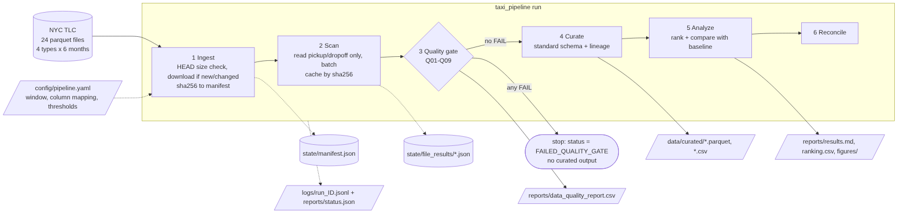
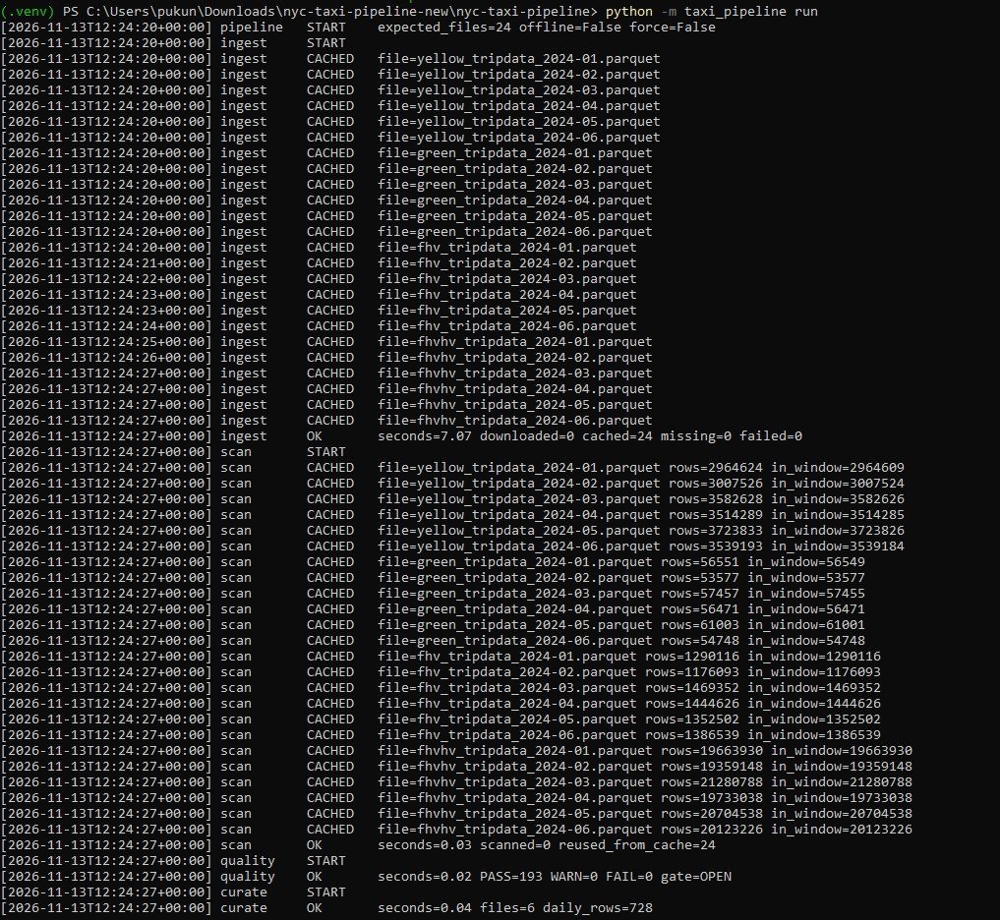
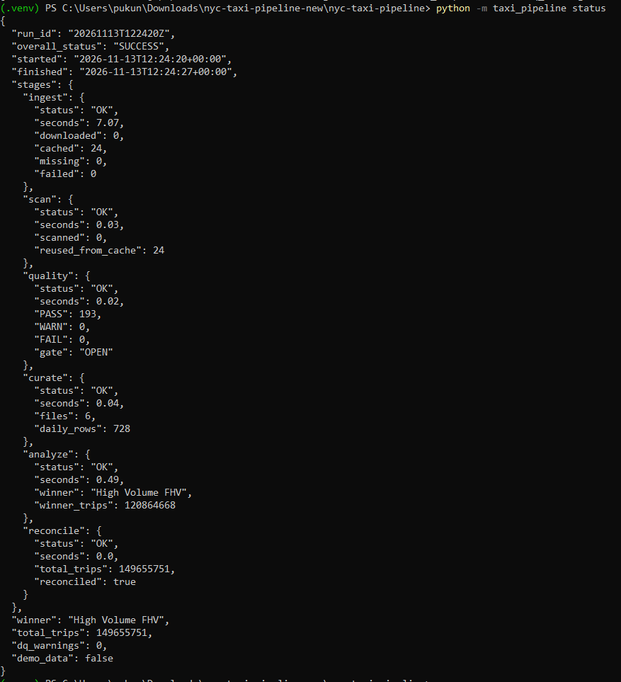

# NYC Taxi — Reproducible Data Pipeline (Submission 2)

## 1.Project Overview
**คำถามหลัก:** Which taxi type was the most used in the first half of 2024?

**นิยาม Most Used:** ประเภท Taxi ที่มีจำนวน Trip Records ซึ่งมีวันที่ Pickup อยู่ระหว่าง 2024-01-01 ถึง 2024-06-30 มากที่สุด

โปรเจกต์นี้พัฒนา Data Pipeline สำหรับรวบรวม ตรวจสอบ จัดเตรียม และวิเคราะห์ข้อมูล NYC Taxi ทั้ง 4 ประเภท โดยเน้นให้สามารถรันซ้ำ อัปเดตข้อมูลใหม่ และตรวจสอบย้อนกลับได้

ผลการวิเคราะห์พบว่า **High Volume FHV** เป็นประเภทที่มีการใช้งานมากที่สุด โดยมีจำนวน 120,864,668 Trips คิดเป็น 80.76% ของข้อมูลทั้งหมดทั้ง 4 ประเภท

## 2. Data Sources

ใช้ข้อมูลจาก NYC TLC Trip Record Data ซึ่งประกอบด้วยข้อมูล Taxi 4 ประเภท ได้แก่

| Taxi Type | ไฟล์ข้อมูล | Pickup Column | Dropoff Column |
|---|---|---|---|
| Yellow | yellow_tripdata_YYYY-MM.parquet | tpep_pickup_datetime | tpep_dropoff_datetime |
| Green | green_tripdata_YYYY-MM.parquet | lpep_pickup_datetime | lpep_dropoff_datetime |
| FHV | fhv_tripdata_YYYY-MM.parquet | pickup_datetime | dropOff_datetime |
| High Volume FHV | fhvhv_tripdata_YYYY-MM.parquet | pickup_datetime | dropoff_datetime |

- แหล่งข้อมูล: https://www.nyc.gov/site/tlc/about/tlc-trip-record-data.page
- Download URL: https://d37ci6vzurychx.cloudfront.net/trip-data
- รูปแบบข้อมูล: Parquet
- ช่วงเวลาที่วิเคราะห์: มกราคม – มิถุนายน 2024
- จำนวนไฟล์ทั้งหมด: 24 ไฟล์ (4 ประเภท × 6 เดือน)
- ขนาดข้อมูลรวมประมาณ 3.3 GB

## 3. Source Code / Repository Structure

โครงสร้างโปรเจกต์แบ่งออกเป็นส่วนต่าง ๆ ตามหน้าที่ของ Pipeline

```text
config/
  pipeline.yaml

src/taxi_pipeline/
  ingest.py
  scan.py
  quality.py
  curate.py
  analyze.py
  pipeline.py
  runlog.py
  demo.py

tests/
  test_pipeline.py

data/
  raw/
  curated/

reports/
  results.md
  ranking.csv
  baseline_comparison.csv
  data_quality_report.csv
  status.json
  figures/

logs/
  run_<id>.jsonl

state/
  manifest.json

docs/
  pipeline_diagram.png
```

**หน้าที่ของแต่ละส่วน**

| Component | หน้าที่ |
|---|---|
| ingest.py | ดาวน์โหลดข้อมูลแบบ Incremental และจัดการ Manifest |
| scan.py | สแกนข้อมูล Pickup/Dropoff แบบ Batch และจัดเก็บ Cache |
| quality.py | ตรวจสอบคุณภาพข้อมูล 9 ข้อ |
| curate.py | รวมข้อมูลจากหลาย Schema ให้เป็นมาตรฐาน พร้อมสร้าง Lineage |
| analyze.py | วิเคราะห์ จัดอันดับ และเปรียบเทียบกับ Baseline |
| pipeline.py | ควบคุมลำดับการทำงานทั้งหมด |
| runlog.py | บันทึกหลักฐานการทำงาน |
| demo.py | สร้างข้อมูลสังเคราะห์สำหรับทดสอบ |
| tests/ | ทดสอบการทำงานของ Pipeline ด้วย Pytest |

## 4. Pipeline / Data Flow



Pipeline ประกอบด้วย 6 ขั้นตอนหลัก

1. **Ingest:** ดาวน์โหลดข้อมูลจาก NYC TLC และจัดเก็บข้อมูลต้นทาง พร้อมบันทึก Manifest และ SHA256
2. **Scan:** อ่านข้อมูลเฉพาะ Pickup และ Dropoff แบบ Batch แล้วนับจำนวน Trip ตามวันที่ Pickup
3. **Quality Gate:** ตรวจสอบคุณภาพข้อมูล หากมีรายการ FAIL จะหยุด Pipeline และไม่เผยแพร่ Curated Output
4. **Curate:** รวมข้อมูลจาก Taxi ทั้ง 4 ประเภทให้อยู่ในรูปแบบมาตรฐาน และสร้าง File Lineage
5. **Analyze:** คำนวณจำนวน Trip จัดอันดับ Taxi Type และเปรียบเทียบผลกับ Baseline
6. **Reconcile:** ตรวจสอบว่าผลรวมข้อมูลรายวัน Lineage และ Ranking มีความสอดคล้องกัน

**การจัดการสถานะ:** หาก Quality Gate มีรายการ FAIL ระบบจะหยุดด้วยสถานะ `FAILED_QUALITY_GATE` และ Exit Code 2 ส่วน WARN จะบันทึกไว้และอนุญาตให้ทำงานต่อ

## 5. How to Setup and Run
### Requirements

- Python
- pip
- Internet connection สำหรับดาวน์โหลดข้อมูลจริง
- พื้นที่จัดเก็บข้อมูลเพียงพอสำหรับไฟล์ต้นทางประมาณ 3.3 GB

### Installation

**Linux / macOS**

```bash
python -m venv .venv
source .venv/bin/activate

pip install -r requirements.txt

export PYTHONPATH=src
```

**Windows PowerShell**

```powershell
python -m venv .venv
.venv\Scripts\Activate.ps1

pip install -r requirements.txt

$env:PYTHONPATH="src"
```

### Run Pipeline

ทดสอบด้วยข้อมูลสังเคราะห์ก่อน

```bash
python -m taxi_pipeline demo
```

รัน Pipeline ด้วยข้อมูลจริง

```bash
python -m taxi_pipeline run
```

ตรวจสอบสถานะการทำงานล่าสุด

```bash
python -m taxi_pipeline status
```

ทดสอบระบบด้วย Pytest

```bash
python -m pytest
```

**Additional Options**

- `--offline` ใช้ไฟล์ที่มีอยู่ใน `data/raw/` เท่านั้น
- `--force` ดาวน์โหลดและสแกนข้อมูลใหม่ทั้งหมด

## 6. Pipeline Execution Evidence & Status

### 6.1 Run Log

ไฟล์ `logs/run_<id>.jsonl` ใช้บันทึกเหตุการณ์ในแต่ละขั้นตอนของ Pipeline พร้อม Timestamp เพื่อให้สามารถตรวจสอบลำดับการทำงานและปัญหาที่เกิดขึ้นได้

### 6.2 Pipeline Status

ไฟล์ `reports/status.json` ใช้แสดงสถานะการทำงานโดยรวม รวมถึงระยะเวลาที่ใช้ในแต่ละ Stage

สามารถตรวจสอบสถานะล่าสุดได้ด้วยคำสั่ง

```bash
python -m taxi_pipeline status
```
### ภาพหลักฐานการรันและสถานะการทำงานของ Pipeline





## 7. Curated Dataset

หลังจากผ่านขั้นตอนตรวจสอบคุณภาพข้อมูลแล้ว ระบบจะสร้างข้อมูลที่พร้อมสำหรับการวิเคราะห์ไว้ใน `data/curated/`

| Dataset | Grain | รายละเอียด |
|---|---|---|
| trips_daily | Taxi Type × Pickup Date | จำนวน Trip รายวันของ Taxi แต่ละประเภท |
| trips_monthly | Taxi Type × Pickup Month | จำนวน Trip สรุปรายเดือน |
| file_lineage | 1 แถวต่อไฟล์ต้นทาง | รายละเอียดไฟล์และจำนวนข้อมูลที่ตรวจสอบได้ |

ข้อมูล Curated ถูกจัดเก็บในรูปแบบ Parquet และ CSV เพื่อให้สามารถนำไปใช้วิเคราะห์ต่อได้

## 8. Data Quality Results
ระบบมีการตรวจสอบคุณภาพข้อมูลทั้งหมด 9 รายการ (Q01–Q09) เพื่อให้มั่นใจว่าข้อมูลที่นำไปวิเคราะห์มีความถูกต้องและครบถ้วน

| ID | รายการตรวจสอบ | เงื่อนไข |
|---|---|---|
| Q01 | ตรวจสอบไฟล์ต้นทาง | FAIL หากไฟล์ไม่ครบ |
| Q02 | ตรวจสอบ Parquet และ Column | FAIL หากอ่านไม่ได้หรือไม่มี Column ที่ต้องการ |
| Q03 | ตรวจสอบจำนวนแถว Metadata กับข้อมูลจริง | FAIL หากไม่ตรงกัน |
| Q04 | ตรวจสอบ Pickup ที่เป็น Null | WARN > 0.1%, FAIL > 5% |
| Q05 | ตรวจสอบ Pickup ที่อยู่นอกช่วงวิเคราะห์ | WARN > 0.5%, FAIL > 10% |
| Q06 | ตรวจสอบ Dropoff ก่อน Pickup | WARN > 0.5% |
| Q07 | ตรวจสอบว่ามี Trip ในช่วงวิเคราะห์ | FAIL หากไม่มี |
| Q08 | ตรวจสอบผลรวมรายวันกับจำนวน In-window | FAIL หากไม่ตรงกัน |
| Q09 | ตรวจสอบความครบถ้วนของ Taxi Type × เดือน | FAIL หากข้อมูลไม่ครบ |

ผลการตรวจสอบถูกจัดเก็บไว้ใน

`reports/data_quality_report.csv`

**การจัดการผลตรวจสอบ**

- PASS: ผ่านเงื่อนไขการตรวจสอบ
- WARN: พบความผิดปกติ แต่ยังสามารถทำงานต่อได้
- FAIL: ไม่ผ่านเงื่อนไข และระบบจะหยุดการเผยแพร่ Curated Output

## 9. Analysis Results
คำถามหลักของโปรเจกต์คือ Taxi Type ใดมีจำนวน Trip มากที่สุดในช่วงครึ่งแรกของปี 2024

ผลการวิเคราะห์พบว่า

**High Volume FHV เป็น Taxi Type ที่มีจำนวน Trip มากที่สุด**

- จำนวน Trip: 120,864,668
- สัดส่วน: 80.76% ของ Trip ทั้งหมดจาก Taxi ทั้ง 4 ประเภท
- มีจำนวน Trip มากกว่าอันดับสอง (Yellow) ประมาณ 5.94 เท่า

ไฟล์ผลลัพธ์ที่เกี่ยวข้อง

| ไฟล์ | รายละเอียด |
|---|---|
| `reports/results.md` | สรุปผลการวิเคราะห์ |
| `reports/ranking.csv` | ผลการจัดอันดับ Taxi Type |
| `reports/baseline_comparison.csv` | เปรียบเทียบกับ Baseline |
| `reports/figures/` | กราฟประกอบการวิเคราะห์ |

## 10. Key Design Decisions
1. **สแกนข้อมูลจริงแทนการใช้ Parquet Metadata เพียงอย่างเดียว** — เนื่องจากการนับจำนวนแถวจาก Metadata อาจรวมข้อมูลที่มีวันที่ Pickup ผิดปกติ จากการตรวจสอบพบข้อมูลผิดช่วงเวลาทั้งหมด 45 แถว (Yellow 39 แถว และ Green 6 แถว) จึงเลือกสแกนข้อมูลจริงโดยอ่านเฉพาะ 2 columns ได้แก่ Pickup และ Dropoff แบบ Batch เพื่อนับจำนวน Trip ตามวันที่ Pickup จริง โดยไม่ต้องโหลดข้อมูลทั้งหมดเข้า Memory และมี Q03 สำหรับตรวจสอบความถูกต้องของจำนวนแถว
2. **เก็บผลการสแกนรายวันของทุกไฟล์** — เลือกเก็บผลการสแกนแยกตามวัน และใช้ SHA256 เป็น Cache Key ทำให้สามารถเปลี่ยนช่วงวันที่วิเคราะห์ได้โดยไม่ต้องสแกนไฟล์เดิมซ้ำ ช่วยลดเวลาในการประมวลผล
3. **Quality gate แบบ fail‑closed** — ถ้ามี FAIL จะไม่เขียน curated/results เลย กันไม่ให้มีคนเอาข้อมูลไม่ครบไปใช้โดยไม่รู้ตัว ส่วน WARN ยังรันต่อแต่บันทึกไว้
4. **ไม่ลบ Duplicate อัตโนมัติ** — เนื่องจากข้อมูลไม่มี Trip ID ที่ใช้ระบุรายการได้อย่างแน่นอน การลบข้อมูลที่มีค่าเหมือนกันอาจทำให้ Trip ที่เกิดขึ้นจริงถูกลบออกไป จึงเลือกเก็บข้อมูลไว้ตามเดิม
5. **เขียนไฟล์แบบ Atomic Write และ Config-driven** — เขียนไฟล์ชั่วคราวเป็น .tmp ก่อนเปลี่ยนชื่อเป็นไฟล์จริง เพื่อลดปัญหาไฟล์เสียหายหากโปรแกรมหยุดทำงานระหว่างเขียนข้อมูล และกำหนดค่าต่าง ๆ ผ่านไฟล์ config เพื่อให้แก้ไขหรือปรับช่วงเวลาการวิเคราะห์ได้ง่ายขึ้น

## 11. Submission 2 พัฒนาจาก Submission 1 อย่างไร
Submission 2 พัฒนาจาก Notebook เดิมให้กลายเป็น Data Pipeline ที่ทำงานเป็นขั้นตอนและตรวจสอบได้มากขึ้น โดยเปลี่ยนจากการนับจำนวนแถวผ่าน Parquet Metadata มาเป็นการสแกนข้อมูลจริงและนับตามวันที่ Pickup ทำให้ผลลัพธ์แม่นยำขึ้น เพิ่มการตรวจสอบคุณภาพข้อมูลจาก 5 เป็น 9 ข้อ พร้อมระบบ Manifest, SHA256 และ Cache เพื่อช่วยลดการดาวน์โหลดและประมวลผลซ้ำ นอกจากนี้ยังแยกโค้ดเป็นโมดูล เพิ่มไฟล์ Log, Lineage และการทดสอบด้วย Pytest

ข้อจำกัดที่ยังมีอยู่: Pipeline ยังทำงานบนเครื่องเดียวและประมวลผลทีละขั้นตอน ทำให้การรันครั้งแรกใช้เวลานาน ยังไม่มีระบบ Scheduler และเก็บเฉพาะข้อมูลสรุปรายวัน ไม่ได้เก็บข้อมูล Trip รายรายการ อีกทั้งยังไม่ได้ตรวจสอบหรือลบ Duplicate อัตโนมัติ และชุดทดสอบยังใช้ข้อมูลจำลองเป็นหลัก ไม่ได้ครอบคลุมการเปลี่ยนแปลง Schema ของข้อมูลจริงในอนาคต

## 12. Learning Reflection
จากการทำ Submission 2 ทำให้ได้เรียนรู้ว่าการพัฒนาระบบ Data Pipeline ไม่ใช่แค่การนำข้อมูลมาวิเคราะห์ แต่ต้องคำนึงถึงความถูกต้องและคุณภาพของข้อมูลในทุกขั้นตอนด้วย ได้เรียนรู้การเปลี่ยนจากการทำงานบน Notebook มาเป็น Pipeline ที่แบ่งขั้นตอนชัดเจน ตั้งแต่การดึงข้อมูล การตรวจสอบคุณภาพ การจัดเตรียมข้อมูล ไปจนถึงการวิเคราะห์ผล สิ่งที่น่าสนใจคือจำนวนข้อมูลจาก Metadata อาจไม่ตรงกับจำนวนข้อมูลจริงที่อยู่ในช่วงเวลาที่ต้องการวิเคราะห์ จึงต้องมีการอ่านและตรวจสอบข้อมูลจริงเพิ่มเติม หากมีโอกาสพัฒนาต่อ อยากเพิ่มประสิทธิภาพการประมวลผลให้รวดเร็วขึ้น และนำระบบไปใช้กับข้อมูลที่มีขนาดใหญ่หรืออัปเดตอยู่ตลอดเวลา
