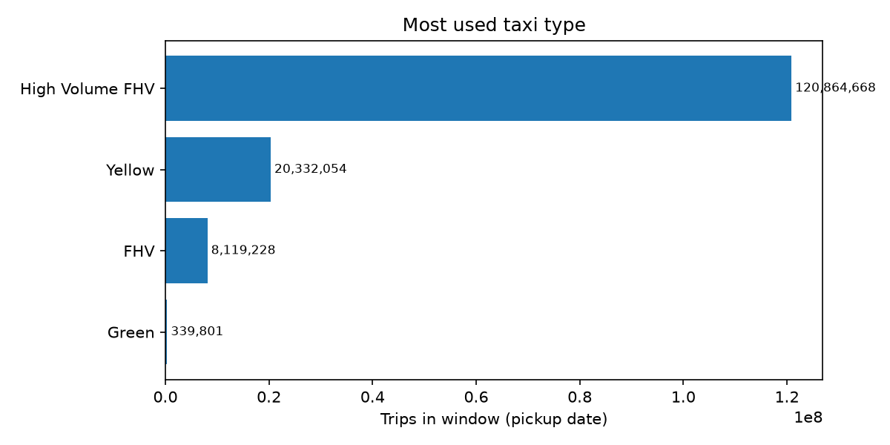
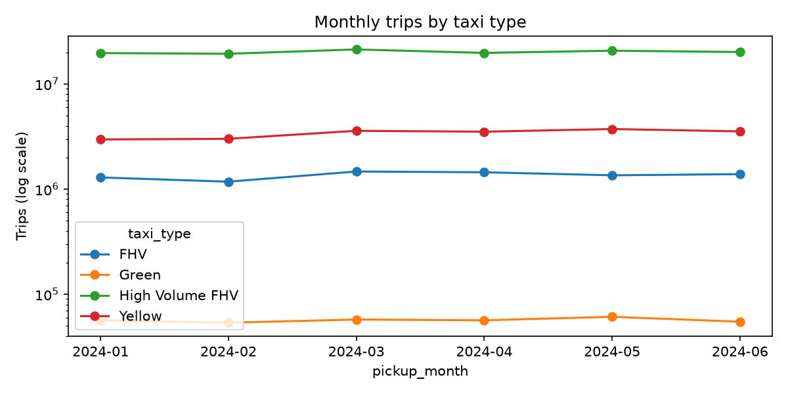

# Result — Which taxi type was the most used?

- Window (pickup date): **2024-01-01 → 2024-06-30**  | run_id: `20261113T122420Z`
- Metric: จำนวน trip records ที่มี pickup date อยู่ในช่วง (ไม่ใช่รายได้/ระยะทาง/ผู้โดยสาร)

## Answer: **High Volume FHV**
120,864,668 trips = 80.76% of all four types; 5.94× the runner-up (Yellow).

## Ranking & comparison with Submission 1 method (metadata row count)

|   rank | taxi_type       |   total_trips |   share_percent |   baseline_total_trips |   excluded_vs_baseline |   excluded_pct |
|-------:|:----------------|--------------:|----------------:|-----------------------:|-----------------------:|---------------:|
|      1 | High Volume FHV |     120864668 |           80.76 |              120864668 |                      0 |         0      |
|      2 | Yellow          |      20332054 |           13.59 |               20332093 |                     39 |         0.0002 |
|      3 | FHV             |       8119228 |            5.43 |                8119228 |                      0 |         0      |
|      4 | Green           |        339801 |            0.23 |                 339807 |                      6 |         0.0018 |

Same winner as baseline method: **True**

## Data quality: 193 PASS / 0 WARN / 0 FAIL (ดูรายละเอียดที่ `reports/data_quality_report.csv`)

